# 光影渲染 RenderLab

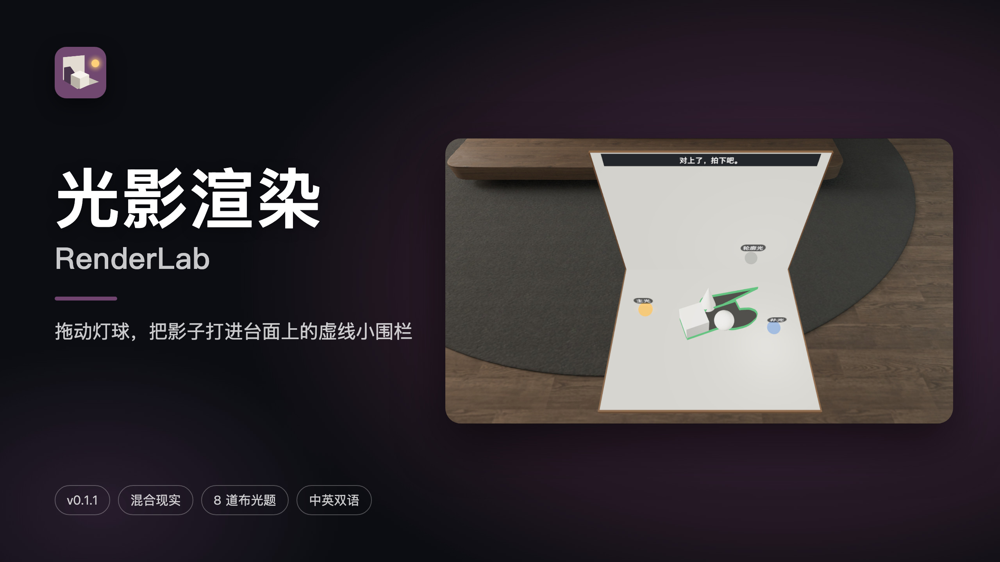

**中文** · [English](#english)

桌上一个小摄影棚：拖动灯球，把石膏、茶壶、花瓶的影子打进台面上的虚线小围栏。

PICO OS 6 空间应用（Full Space · Mixed Stage，Spatial SDK 6.1.9）。透视着你的房间，桌高处摆一个小摄影棚，里面有一件主体和三颗灯球（主光 / 补光 / 轮廓光）；前上方一块控制窗。全部本机运行，不联网、不需要账号。

## 怎么玩

- 捏住灯球拖动，明暗、高光、影子实时跟着走；灯球旁边写着「右前 40° · 高 35°」
- 三种拿法都行：手直接捏、手柄射线 + 扳机、眼睛看着 + 手指捏合
- 台面上的虚线小围栏是这道题要的影子；影子进框，围栏变绿，[拍下] 也变绿
- 控制窗上两条滑条调选中那盏灯的亮度和色温；对准度卡写着影子重合多少、还差哪一条
- [拍下] 给 0–3 星，附一句「为什么这样打光」

## 8 道场面题 + 随机一题 + 自由打光

- L1 侧光拉影 · L2 侧光切一半 · L3 三大面 · L4 高侧光
- L5 逆光描边 · L6 冷暖对打 · L7 金属一道光 · L8 关灯夜光
- 随机一题：灯位随机，永远有下一题
- 自由打光：三盏灯全开，主体（石膏 / 茶壶 / 花瓶）、材质（石膏白 / 青瓷 / 拉丝金 / 黑橡胶 / 夜光釉）、背景（白棚 / 黑棚 / 暮色）随便换

## 截图

| | |
|---|---|
| 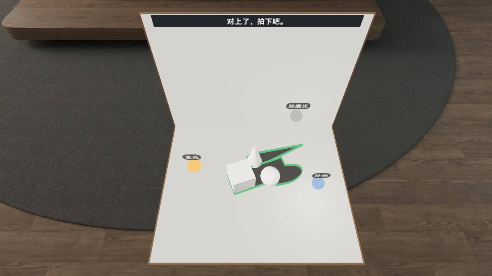 对上了：影子进框，围栏变绿 | 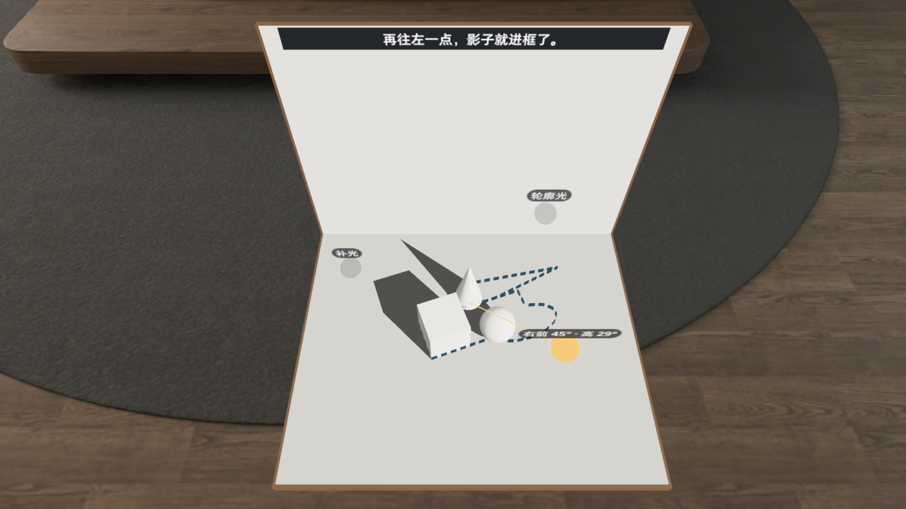 拖主光：灯球旁实时写方位和高度 |
|  控制窗：对准度卡 + 亮度 / 色温滑条 |  拍下：3 / 3 星，附一句为什么 |
| 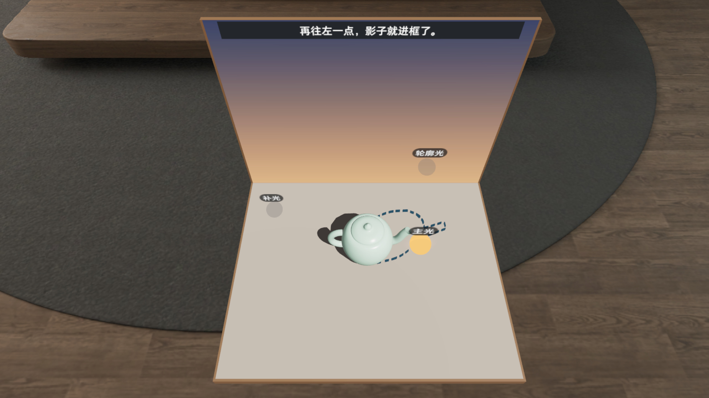 L6 冷暖对打：暮色背景里的青瓷茶壶 | 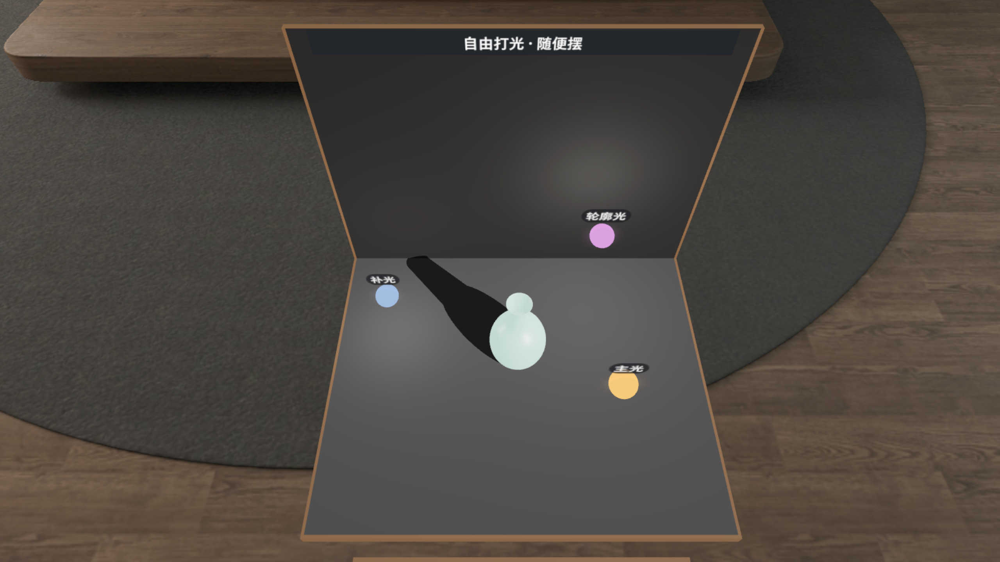 自由打光：黑棚、夜光釉花瓶，三盏灯全开 |
| 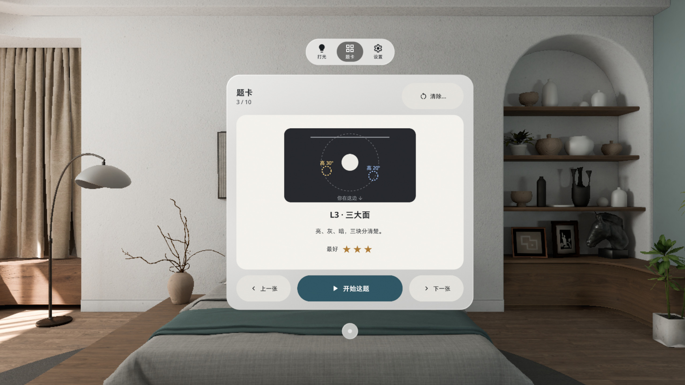 题卡：8 道场面题 + 随机一题 + 自由打光 | |

截图和演示视频在 PICO 模拟器上录制，3D 操作由调试广播驱动，**非真实手势录像**。

## 安装

```bash
adb install -r RenderLab-v0.1.1.apk
pico-cli app launch io.embodit.renderlab
```

Release 里的 APK 是 `./gradlew assembleRelease` 出的未签名包，用于提交 Vibe Lab；自己装机请先用自己的 key 签名，或在本仓库 `./gradlew assembleDebug` 出调试包安装。

## 构建

```bash
export JAVA_HOME=<JDK 17+>
./gradlew assembleDebug :app:testDebugUnitTest   # JVM 单测：影子 / 判分 / 阈值 / 可见性、流程、布局、摆位、命中回放
```

工程结构、调试命令见 [AGENTS.md](AGENTS.md)。

## 已知问题 / 真机待核

- 三种拖灯方式（手直接捏 / 手柄射线 / 眼手）只在代码路径和命中回放里验过，模拟器没有手和手柄，要真机确认
- 英文 3D 字条在模拟器截图里画面右半边像斜体；贴图本身是正的，疑似模拟器合成问题，真机再看
- 摄影棚放在桌高、手够得着的地方，主体在视线下约 52°；墙顶和控制窗底部系统控件之间约 9°
- 名牌放大后 L2 解题位「主光」牌会压住「补光」牌；自由打光和 L1 开局主光球会挡在主体前面

## 致谢 / 许可

- 字体 Noto Sans（SIL OFL 1.1）；图标 Material Symbols（Apache 2.0）
- 音效：Kenney Impact Sounds（CC0）、freesound 254343（CC0）
- 主体（石膏几何组、茶壶、花瓶）全部程序化生成，不含外部模型

---

## English

A tiny tabletop studio. Drag the lights until the shadow fills the little dashed fence on the floor.

A PICO OS 6 spatial app (Full Space · Mixed Stage, Spatial SDK 6.1.9). With your room in passthrough, a small photo studio sits at desk height: one subject and three light orbs (key, fill, rim), with a control window above it. Runs fully on device: no network, no account.

### How to play

- Pinch a light orb and drag it; light, highlights and shadow follow live, and the orb shows "front-right 40° · up 35°"
- Three ways to grab: pinch it directly, controller ray + trigger, or look at it and pinch
- The dashed fence on the floor is the shadow this shot wants; get the shadow in and the fence turns green, so does [Shoot]
- Two sliders on the control window set brightness and colour temperature of the selected light; the alignment card says how much the shadow overlaps and what is still missing
- [Shoot] gives 0–3 stars and one line on why the light works

### 8 shots + a random one + free lighting

- L1 Long side shadow · L2 Split light · L3 Three faces · L4 High side light
- L5 Rim light · L6 Warm meets cool · L7 One streak on metal · L8 Lights out, glow on
- Random: a random light setup, there is always another
- Free lighting: all three lights on; swap the subject (plaster set / teapot / vase), material (plaster / celadon / brushed gold / black rubber / glow glaze) and backdrop (white / black / dusk)

### Screenshots

| | |
|---|---|
| 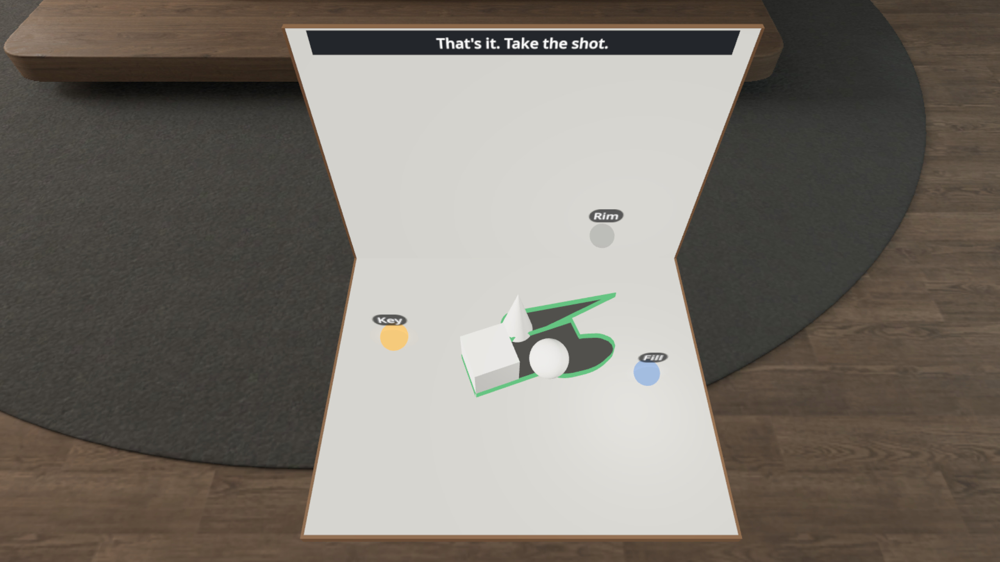 That's it: the shadow is in, the fence turns green | 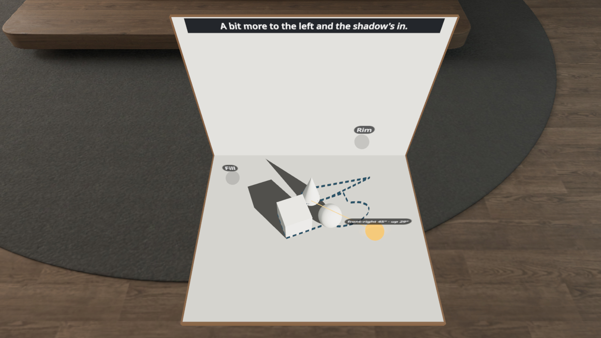 Dragging the key light: angle and height next to the orb |
| 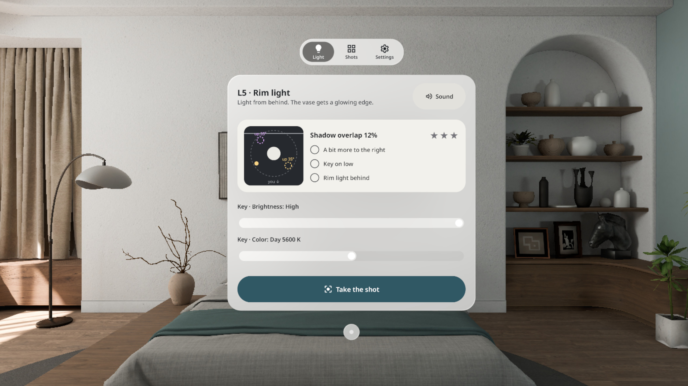 Control window: alignment card + brightness / colour sliders | 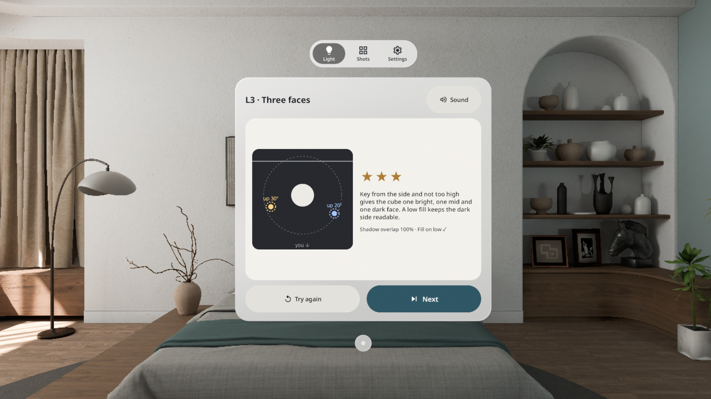 Shot taken: 3 / 3 stars and why |
|  L6 Warm meets cool: a celadon teapot against dusk | 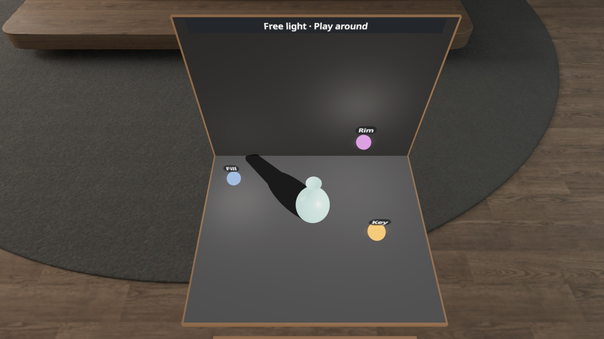 Free lighting: glow-glaze vase in the black studio, all three lights on |
| 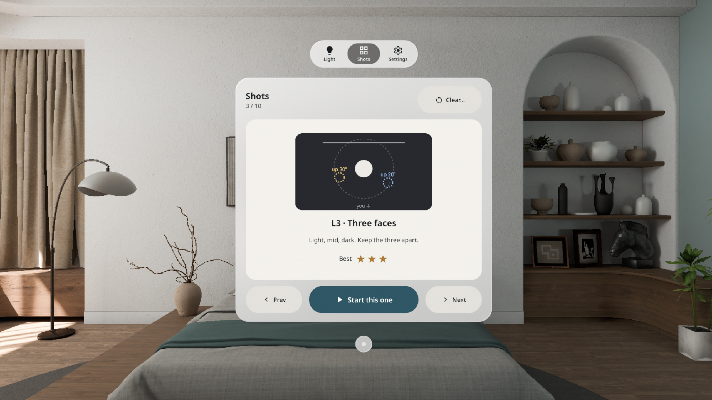 Shot cards: 8 shots + random + free lighting | |

Screenshots and the demo video were recorded on the PICO emulator with 3D actions driven by debug broadcasts. **Not a real hand-gesture recording.**

### Install

```bash
adb install -r RenderLab-v0.1.1.apk
pico-cli app launch io.embodit.renderlab
```

The APK on the Release is the unsigned `assembleRelease` build used for the Vibe Lab submission; sign it with your own key before installing, or build a debug APK from this repo with `./gradlew assembleDebug`.

### Known issues / to check on the headset

- The three ways to drag a light (direct pinch / controller ray / eye + pinch) are verified only through code paths and hit replay; the emulator has no hands or controller
- English 3D strip text looks slanted on the right half of emulator captures; the texture itself is upright, likely an emulator compositing issue
- The studio sits at desk height within reach, so the subject is about 52° below eye level; about 9° between the wall top and the window's system controls
- With the larger name plates, the "Key" plate covers the "Fill" plate at the L2 solution; in free lighting and at the L1 start the key orb sits in front of the subject

### Credits / licences

- Font Noto Sans (SIL OFL 1.1); icons Material Symbols (Apache 2.0)
- Sounds: Kenney Impact Sounds (CC0), freesound 254343 (CC0)
- All subjects (plaster set, teapot, vase) are generated procedurally; no external models
